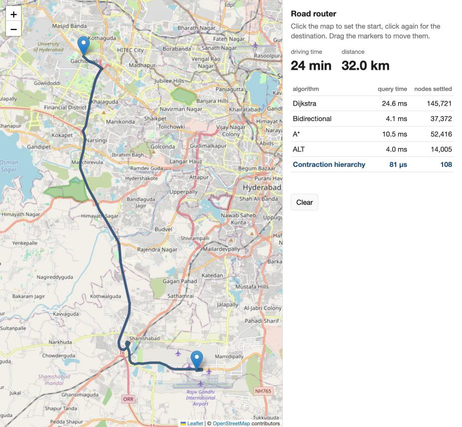
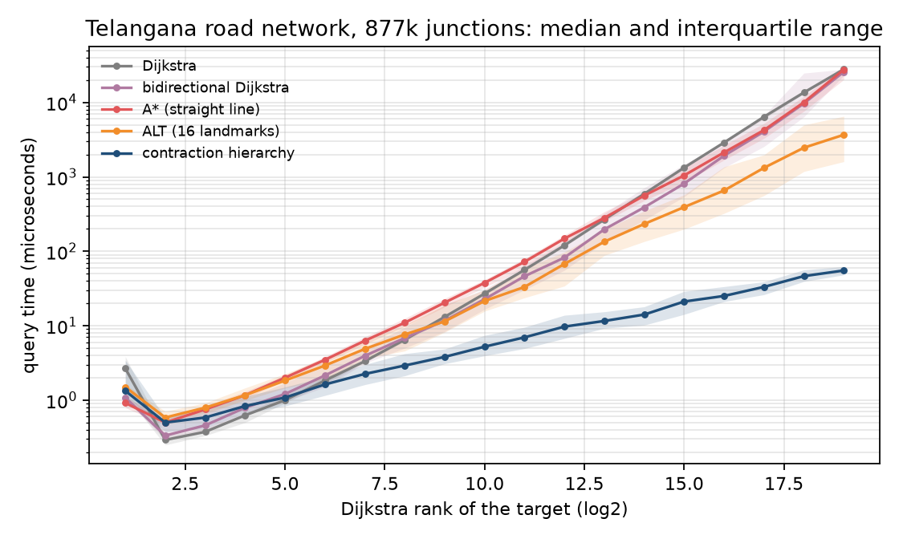

# osm-routing-engine

Road routing on OpenStreetMap data, in C++17 with no dependencies beyond zlib. It goes from a raw `.osm.pbf` extract to a clickable map. It:

- reads the PBF format itself,
- builds a car road graph,
- answers shortest-path queries with Dijkstra, bidirectional Dijkstra, A*, ALT and contraction hierarchies,
- computes many-to-many travel-time tables,
- serves routes over HTTP.

On the Telangana road network (877k junctions, 2.2M road segments), a contraction-hierarchy query takes **19 µs** on average, about 1,200 times faster than Dijkstra. A 5000 x 5000 travel-time matrix takes **0.5 s**. On every benchmark query, every algorithm's answer is checked against plain Dijkstra.



*IIIT Hyderabad to the airport: 32.0 km and 24 minutes at free-flow speeds, along the Outer Ring Road. The panel times all five algorithms on the same query.*

## Results

Telangana extract from openstreetmap.fr (104 MB, November 2026). Apple M4 Pro, one thread per query.

| stage | time |
|---|---|
| read PBF (13.4M nodes, 2.3M ways, 12 threads) | 0.3 s |
| build graph: 3.6M road nodes into 877k junctions and 2.2M directed edges | 0.8 s |
| contraction hierarchy: 1.75M shortcuts (0.79 per edge) | 7.1 s |
| ALT: 16 landmarks | 1.6 s |

1000 random source-target pairs:

| algorithm | mean | median | 99th pct | nodes settled | answers different from Dijkstra |
|---|---:|---:|---:|---:|---:|
| Dijkstra | 23.7 ms | 23.9 ms | 47.1 ms | 440,913 | - |
| bidirectional Dijkstra | 20.4 ms | 23.3 ms | 43.3 ms | 334,055 | 0 |
| A* (straight-line bound) | 22.1 ms | 17.7 ms | 63.7 ms | 271,192 | 0 |
| ALT (16 landmarks) | 6.0 ms | 2.8 ms | 37.0 ms | 48,892 | 0 |
| **contraction hierarchy** | **19.2 µs** | **18.4 µs** | **49 µs** | **204** | **0** |

The first 1000 CH answers are also unpacked into road edges. Each one is checked to be a connected path from s to t whose weights add up to the reported time. None failed.

Query time against Dijkstra rank, from 100 random sources. The target of rank 2^r is the 2^r-th node Dijkstra settles, so the x axis runs from next door to the far side of the state:



The searches on the plain graph grow linearly with the area they cover. CH grows only logarithmically. At the farthest rank (2^19) the medians are 28 ms for Dijkstra, 3.7 ms for ALT and 55 µs for CH: about 500 times faster than Dijkstra and 67 times faster than ALT.

Many-to-many tables (bucket-based CH, Knopp et al. 2007), random points:

| table | CH buckets | one Dijkstra per row (est.) | one CH query per pair (est.) |
|---|---:|---:|---:|
| 1000 x 1000 | 0.036 s | 47 s | 15 s |
| 5000 x 5000 | 0.51 s | 233 s | 377 s |

Each run checks 20 full rows against Dijkstra, every entry. None differed.

### Scaling to South India

The same pipeline ran on five state extracts merged into one graph: Telangana, Andhra Pradesh, Karnataka, Tamil Nadu and Kerala (604 MB of PBF). Ways that cross state borders appear in two files and are kept once.

| | Telangana | South India |
|---|---:|---:|
| junctions / directed edges | 877k / 2.2M | 5.49M / 13.6M |
| build graph (peak memory) | 1.3 s (1.0 GB) | 10.0 s (3.9 GB) |
| contraction (peak memory) | 7.1 s | 40.8 s (2.6 GB) |
| shortcuts per road edge | 0.79 | 0.76 |
| Dijkstra, mean query | 23.7 ms | 169 ms |
| ALT, mean query | 6.0 ms | 23.1 ms |
| CH, mean / median query | 19.2 / 18.4 µs | 47.8 / 38.7 µs |
| CH speedup over Dijkstra | 1,236x | 3,532x |
| 1000 x 1000 table | 0.036 s | 0.059 s |
| 5000 x 5000 table | 0.51 s | 0.60 s |

With 6.3 times the nodes, contraction took 5.7 times longer, Dijkstra 7 times longer, and a CH query 2.5 times longer. All 500 random queries on the large graph agree with Dijkstra for every algorithm, and all 500 CH paths unpack correctly.

## How it works

1. **PBF reader** (`src/pbf.cpp`). It decodes the protobuf wire format by hand (varints, zigzag, packed delta-coded arrays), memory-maps the file and inflates blobs on all cores. Its node, way and reference counts and its id and coordinate checksums match pyosmium exactly (`bench/validate_pbf.py`).
2. **Graph builder** (`src/build.cpp`).
   - A car profile sets road classes, speeds, `maxspeed`, access and one-way rules.
   - Ways are split only at junctions; shape points are kept as geometry.
   - Edge weights are travel times in tenths of a second, rounded up.
   - Only the largest strongly connected component is kept.
   - Nodes are renumbered along a Z-order curve for cache locality.
3. **Searches** (`src/search.hpp`). They use timestamped labels, so nothing is reset between queries, and a heap with lazy deletion. A* and ALT use consistent potentials, so they are exact.
4. **Contraction hierarchies** (`src/ch.cpp`).
   - Nodes are ordered by edge difference, deleted neighbours and level, with lazy priority updates.
   - Witness searches are bounded.
   - Queries are bidirectional upward searches with stall-on-demand.
   - Shortcuts unpack recursively into road edges.
   - Many-to-many tables use buckets.
5. **Server** (`src/server.cpp`, `web/index.html`). Plain sockets plus a grid index for snapping clicks to junctions, and a Leaflet page.

[docs/how-it-works.md](docs/how-it-works.md) has the details, the correctness arguments and the bugs found on the way.

## Usage

```bash
make && make test

./router build data/telangana.osm.pbf data/telangana.graph      # several .pbf files can be merged
./router contract data/telangana.graph data/telangana.ch
./router bench data/telangana.graph data/telangana.ch --queries 1000
./router table data/telangana.graph data/telangana.ch --size 1000
./router rank  data/telangana.graph data/telangana.ch --sources 100 --csv rank.csv
./router serve data/telangana.graph data/telangana.ch --port 8080   # then open http://127.0.0.1:8080
```

HTTP endpoints:

```
GET /route?from=17.4455,78.3489&to=17.2403,78.4294[&algo=ch|dijkstra|bidirectional|astar|alt]
GET /compare?from=...&to=...                  all five algorithms on one query
GET /table?points=lat,lon;lat,lon;...         travel-time matrix, up to 2000 points
```

Data: `curl -LO http://download.openstreetmap.fr/extracts/asia/india/telangana-latest.osm.pbf` (other states use the same URL pattern). Any OpenStreetMap PBF extract works.

## Layout

```
src/pbf.*        PBF reader and protobuf decoding
src/build.*      car profile, OSM to junction graph
src/graph.*      CSR graph, SCC, Z-order renumbering, save/load
src/search.hpp   Dijkstra, bidirectional, A*, ALT
src/ch.*         contraction, CH query, path unpacking, distance tables
src/server.cpp   HTTP server
web/index.html   map page
tests/           correctness tests on random cities (5000 queries, all algorithms vs Dijkstra)
bench/           pyosmium cross-check, plots, results
```

## Limits

- Turn restrictions and turn costs are ignored (OSM relations are not read), so a route may include a turn that is not allowed, and U-turns at junctions are free.
- Speeds are free-flow estimates from the road class. There is no traffic model, so city times are optimistic.
- The A* straight-line bound has to assume the fastest road in the whole graph (120 km/h here). It is valid but loose, which is why plain A* barely beats Dijkstra.
- Contraction runs on one thread.
- The server handles one request at a time and binds to localhost. It is a demo, not a production service.
- Clicks snap to the nearest junction, not to the nearest point on a road.
